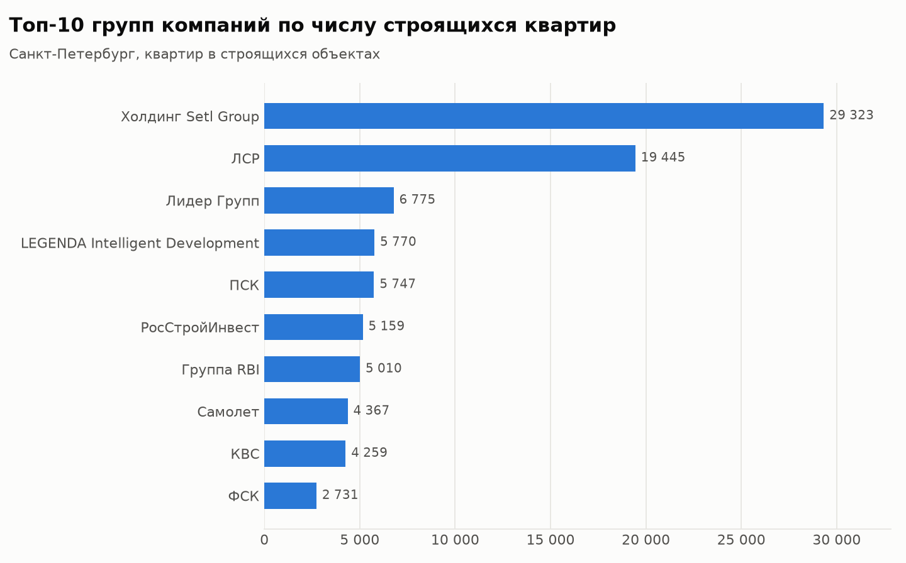
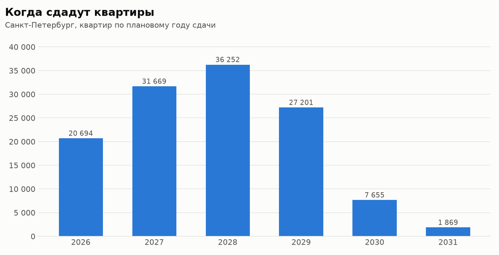
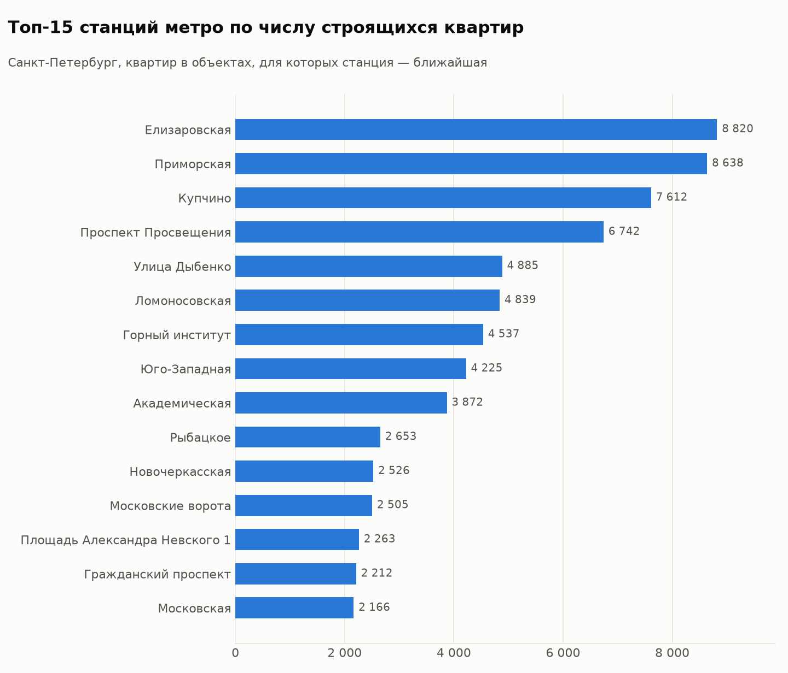

# Новостройки Санкт-Петербурга: парсер и аналитика рынка

Python-проект собирает данные о строящихся объектах из каталога новостроек
[наш.дом.рф](https://наш.дом.рф) (ЕИСЖС), очищает их и строит аналитику первичного рынка:
объём предложения, доли групп компаний, сроки ввода, транспортная доступность и цены.

## Зачем

Это типовая задача аналитика в консалтинге по недвижимости: собрать базу строящихся объектов
(конкурентное окружение будущего проекта), посчитать структуру предложения и сформулировать выводы.
Вручную это несколько дней работы, а скрипт собирает 450+ объектов по Петербургу примерно за минуту
и позволяет обновлять базу каждый месяц.

## Результаты

Ключевые выводы последнего запуска с цифрами — в файле [output/summary.md](output/summary.md).
Полные таблицы — в Excel-отчёте `output/novostroyki_report.xlsx`.





## Что получается на выходе

| Файл | Что внутри |
|---|---|
| `output/novostroyki_report.xlsx` | Excel-отчёт: сводка, все объекты, сводные таблицы по группам компаний, юрлицам застройщиков, годам сдачи, станциям метро и типу объекта, описание полей |
| `output/objects.csv` | Таблица объектов для Power BI или Google Sheets |
| `output/charts/*.png` | Графики: топ-10 групп компаний, ввод по годам, топ-15 станций метро |
| `output/map.html` | Интерактивная карта строящихся объектов (открывается в браузере) |
| `output/summary.md` | Ключевые выводы с цифрами, сформированные автоматически |

## Источник данных и этичный парсинг

- **Источник** — Единая информационная система жилищного строительства. Застройщики обязаны раскрывать
  в ней информацию о строящихся домах (214-ФЗ), поэтому данные публичные.
- **Как берутся данные.** Страница каталога в браузере подгружает данные в формате JSON — это видно
  во вкладке Network инструментов разработчика. Парсер обращается к тому же адресу, фильтрует по региону
  (`place=78`) и забирает данные постранично, по 50 объектов.
- **Бережное отношение к сайту:**
  - перед сбором парсер проверяет `robots.txt`;
  - между запросами делает паузу 1–2,5 секунды;
  - при ошибках повторяет запрос с нарастающей паузой;
  - сохраняет сырые ответы, чтобы не скачивать одно и то же повторно.
- **Назначение.** Проект учебный и аналитический.

## Как запустить

1. Установите Python 3.10 или новее с [python.org](https://www.python.org/downloads/).
   На Windows при установке отметьте галочку **Add Python to PATH**.
2. Откройте терминал в папке проекта. На Windows: откройте папку в Проводнике, наберите `cmd`
   в адресной строке и нажмите Enter. На Mac: в Терминале введите `cd `, перетащите папку в окно
   и нажмите Enter. Затем выполните команды (на Mac — `python3` и `pip3` вместо `python` и `pip`):

```bash
pip install -r requirements.txt

python main.py --demo          # проверка на демо-данных, без интернета
python main.py                 # сбор по Санкт-Петербургу и отчёт
python main.py --region 47     # Ленинградская область
python main.py --max-pages 2   # пробный сбор: только 2 страницы
python main.py --from-raw data/raw/objects_78.json   # пересобрать отчёт без повторного сбора
```

3. Результаты появятся в папке `output/`.

Тесты запускаются командой `python -m pytest`.

## Как устроен код

| Файл | Роль |
|---|---|
| `config.py` | Все настройки: адрес API, регион, паузы, папки |
| `domrf_parser.py` | Сбор данных: постраничные запросы, повтор при ошибках, подбор формата фильтра по региону, сохранение сырых ответов |
| `cleaner.py` | Очистка: выбор полей, приведение типов, застройщик и группа компаний, метро, производные показатели |
| `analysis.py` | Сводные таблицы, графики, Excel-отчёт, карта, текст с выводами |
| `main.py` | Запуск всех шагов по порядку |
| `tests/` | Тесты: парсер проверяется на «поддельном» сайте, очистка — на записях в формате наш.дом.рф |
| `data/demo/` | Демо-набор из **выдуманных** объектов в формате сайта — только для проверки кода |

Схема работы: **сайт → `domrf_parser` (сырые JSON) → `cleaner` (таблица pandas) → `analysis` (отчёт)**.

## Методика

- **Объект строительства** — единица учёта ЕИСЖС. В одном объекте может быть несколько жилых корпусов
  (поле `residentialBuildings`). **ЖК** считаются по уникальным коммерческим названиям.
- **Только жилые объекты.** Показатели рынка жилья считаются по объектам с типом «Жилое».
  Нежилые объекты (в них нет квартир — это, как правило, паркинги, коммерческие и социальные здания)
  выводятся отдельной строкой и остаются в Excel на листах «Объекты» и «По типу объекта».
- **Группа компаний.** Крупные девелоперы оформляют каждый проект на отдельное юрлицо —
  специализированного застройщика (СЗ). Поэтому доли рынка считаются по группам компаний (поле `groupName`).
  Если группа не указана, застройщик считается самостоятельной группой.
- **Цена м²** — средневзвешенная по жилой площади: крупные объекты весят больше маленьких.
  Цена указана не у всех объектов, и доля объектов с ценой выводится в отчёте.
- **Метро** — ближайшая станция и время до неё по данным сайта. По признаку `isWalk` видно,
  пешком это время или на транспорте.
- **Средняя площадь квартиры** = жилая площадь / число квартир. Это оценка: жилая площадь меньше общей.
  В нежилых объектах (апарт-комплексах) квартир по данным сайта нет.
- **«Плановый срок прошёл»** — плановая дата ввода раньше даты сбора, а объект всё ещё числится строящимся.
  Такие объекты стоит проверить на перенос сроков.

## Ограничения и развитие

- **Районы.** В адресах на сайте район обычно не указан, поэтому география показана по ближайшему метро.
  Следующий шаг — определять район по координатам, через границы районов из OpenStreetMap.
- **Доступность.** Можно построить изохроны пешей и транспортной доступности до метро в QGIS.
- **Мониторинг.** Ежемесячный автозапуск позволит отслеживать переносы сроков и выход новых проектов.
- **Дашборд.** На основе `objects.csv` можно собрать дашборд в Power BI.

## Если что-то перестало работать

Сайты меняют формат ответов. На этот случай в парсере есть диагностика:

- **Сайт вернул не JSON.** Ответ сохраняется в `data/raw/debug_response.html`.
- **Не нашлись нужные поля.** Парсер печатает, какие поля есть в ответе. Их названия правятся
  в одном месте — в словаре `FIELD_MAP` в `cleaner.py`.
